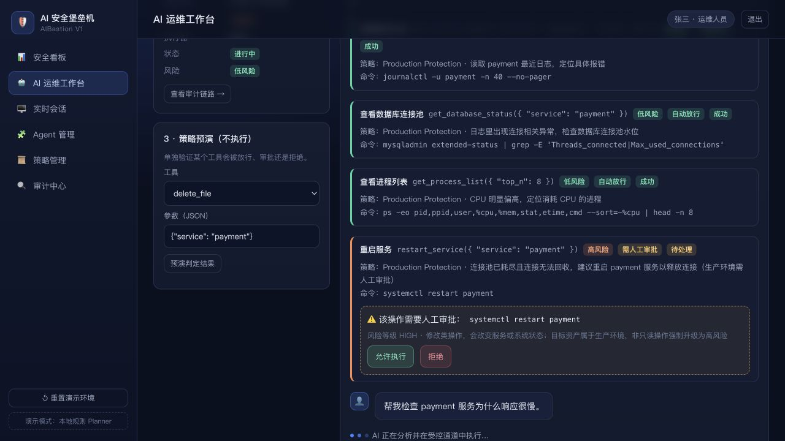
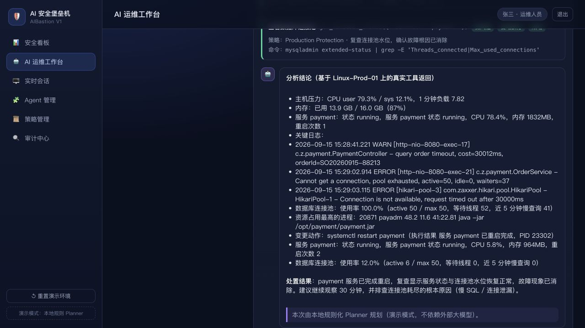
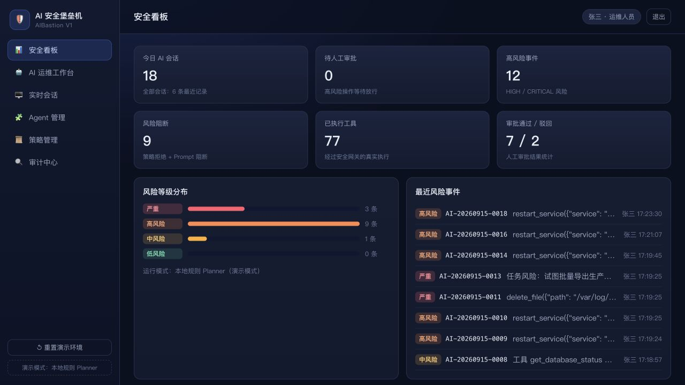
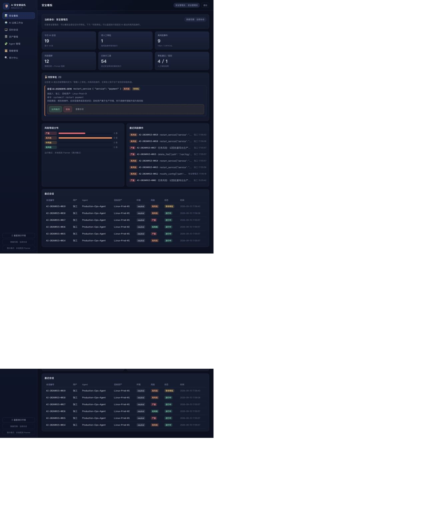

# AI 安全堡垒机 V1（AIBastion）

> **AI 堡垒机是企业 AI Agent 的特权访问控制入口**：让企业能够安全地使用 AI 自动执行运维任务，
> 并实现身份、权限、风险、审批和全链路审计。

这不是一个「会调用大模型的堡垒机」，而是一道**AI 与生产系统之间的强制闸门**：
AI 提出的每一个动作，都必须经过身份权限校验 → 策略引擎 → 风险引擎 → 人工审批 → 执行代理，
而且全过程可还原、可导出、可追责。

---

## 一、5 分钟跑起来

### macOS / Linux

```bash
./start.sh                 # 自动建虚拟环境 + 装依赖 + 启动
# 或者手动：
python3 -m venv .venv
./.venv/bin/pip install -r requirements.txt
./.venv/bin/python run.py
```

### Windows Server / Windows 10+

```bat
start.bat
```

浏览器打开 <http://127.0.0.1:8000>（`run.py --port 9000` 可换端口）。

### 演示账号

| 角色 | 账号 | 密码 | 能做什么 |
| --- | --- | --- | --- |
| 运维人员 | `zhangsan` | `ops123456` | 只看到**自己的**会话与待审批；创建 AI 会话、下达任务、审批自己发起的操作 |
| 安全管理员 | `secadmin` | `sec123456` | 看到**全部**会话；在「待我审批」里放行/驳回高风险操作、添加 Linux 资产、管理 Agent 与策略、强制终止会话 |
| 审计管理员 | `auditor` | `audit123456` | **只读**视角：检索全部会话、还原完整链路、导出审计报告（不能下达 AI 任务） |

三种角色登录后菜单与数据范围不同，不是同一个页面换个标题：

| 页面 | 运维人员 | 安全管理员 | 审计管理员 |
| --- | --- | --- | --- |
| 安全看板 | ✅ 仅自己 | ✅ 全局态势 + 待我审批 | ✅ 全局只读 |
| AI 运维工作台 | ✅ | ✅ | ⛔ 菜单不显示 |
| 实时会话 | ✅ 自己的 | ✅ 全部 + 强制终止 | ✅ 全部只读 |
| 资产管理 | 查看授权给自己的 | ✅ 增删改 + 连通性测试 | 只读 |
| Agent 管理 | 只读 | ✅ 编辑工具/资产/用户授权 | 只读 |
| 策略管理 | 只读 | ✅ 增删规则 | 只读 |
| 审计中心 | 自己的会话 | 全部 | 全部 + 导出报告 |

> 默认 **演示模式**：使用本地规则化 Planner，**不依赖任何大模型 API、不依赖真实 Linux 主机**，
> 断网也能完整演示。要接真实大模型或真实服务器，见第六节。

---

## 二、一键验证闭环（不用打开浏览器）

```bash
./.venv/bin/python tools/e2e_demo.py        # 跑完整 Demo 故事并打印审计链路
./.venv/bin/python tools/verify_scenarios.py --base http://127.0.0.1:8000   # 5 个安全场景断言
```

`verify_scenarios.py` 当前结果：**通过 30 项，失败 0 项**

| 场景 | 验证内容 |
| --- | --- |
| 1 正常闭环 | 只读诊断自动放行 → 重启服务判定 HIGH → 人工审批 → 真实执行 → 复查 |
| 2 人工拒绝 | 审批驳回后，工具状态为 `denied`，目标机上不会下发任何命令 |
| 3 策略红线 | AI 请求删除文件，被 DENY 策略拦截，无法通过审批绕过 |
| 4 权限约束 | 用户本人没有该资产权限时，同一个 Agent 也被拦截（Agent 权限 ≤ 用户权限） |
| 5 Prompt 风控 | 「导出生产数据库」在进入 AI 规划之前就被阻断，风险等级 CRITICAL |
| 6 角色分离 | 审计员不能建会话/下任务、运维不能改 Agent 与策略、运维的审计列表只有自己的会话 |
| 7 资产管理 | 安全管理员新增 SSH 资产、凭据不落库、目标不可达时明确报失败、运维无权增删资产 |
| 8 跨角色闭环 | 运维发起 → 会话出现在安全管理员的「待我审批」→ 审批后真实执行 → 审计员导出 CSV 报告 |

---

## 三、界面

**AI 运维工作台：高风险操作正在等待人工审批**



**审批通过后：AI 给出基于真实工具返回的根因分析**



**安全看板：会话、风险、阻断、审批态势**



**审计中心：一条会话的完整链路还原（用户 → Prompt → AI → Tool → 风险 → 审批 → 命令 → 服务器 → 结果）**


**资产管理：纳管真实 Linux（SSH），一键测试连通性，凭据不落库**


**安全管理员看板：AI 提出的高风险操作在「待我审批」里直接放行或驳回**



---

## 四、核心安全链路

AI 永远拿不到 shell，它只能提出**结构化工具调用请求**：

```
用户自然语言任务
      │
      ▼
  Prompt 风控检测 ────────► 命中红线：直接阻断，不进入 AI
      │
      ▼
   AI Agent（Planner / LLM）       ← 只有「建议权」
      │  提出 tool_call
      ▼
┌──────────────────────────────────────────────┐
│ Tool Gateway（唯一执行入口）                  │
│  1. 身份权限校验：Agent 白名单 / 资产授权 /    │
│     用户授权（Agent 权限 ≤ 用户权限）          │
│  2. Policy Engine：ALLOW / APPROVAL / DENY    │
│  3. Risk Engine：LOW → CRITICAL + 可读原因     │
│  4. 风险升级：ALLOW 但风险高 → 强制人工审批     │
│     风险阻断：CRITICAL → 拒绝，审批也无法绕过   │
│  5. Approval：人工点击「允许 / 拒绝」           │
└──────────────────────────────────────────────┘
      │ 参数白名单校验 + 固定命令模板渲染
      ▼
 SSH Proxy（mock 模拟主机 / 真实 Linux / 本机）
      │
      ▼
  目标服务器（payment / nginx / mysqld …）
      │
      ▼
 全链路审计：数据库 + JSONL 落盘 + 会话导出（JSON/CSV）
```

### 五条安全原则的落地位置

| 原则 | 实现位置 |
| --- | --- |
| 一、AI 没有最终执行权 | 只有 `backend/app/security/gateway.py` 能执行工具，AI 层无法直接触碰执行代理 |
| 二、Agent 权限不能超过用户权限 | `gateway.authorize()` 中同时校验 `agent_assets` 与 `user_assets` |
| 三、高风险操作脱离 AI 自主决策 | `security/risk.py` + `security/approvals.py`，审批通过前命令不下发 |
| 四、所有 AI 操作可追溯 | `audit/logger.py`：每个环节落 `audit_events` + `data/audit/*.jsonl` |
| 五、会话结束临时权限立即失效 | `runner.finish_session()`：清理待审批请求并终止运行中的任务 |

---

## 五、工程结构

```
ai-pam/
├── run.py                     # 一键启动（Windows 也能直接跑）
├── start.sh / start.bat       # 自动建环境 + 启动
├── requirements.txt
├── backend/
│   ├── config/
│   │   └── tools.yaml         # AI 可用工具白名单（唯一的工具来源）
│   └── app/
│       ├── main.py            # FastAPI 入口 + 静态前端
│       ├── settings.py        # 全部配置项（支持环境变量覆盖）
│       ├── db.py / schema.sql # SQLite 数据层（11 张表）
│       ├── seeds.py           # 演示数据：3 用户 / 4 资产 / 2 Agent / 3 策略 / 2 历史会话
│       ├── events.py          # 进程内事件总线（WebSocket 实时推送）
│       ├── api/               # auth / catalog / sessions / approvals / audit / dashboard / realtime / demo
│       ├── ai/                # llm.py（OpenAI 兼容）· planner.py（离线规则 Planner）
│       │                      # runner.py（Agent 主循环）· tools.py · prompts.py
│       ├── security/          # auth.py · gateway.py · policy.py · risk.py · approvals.py
│       │                      # secrets.py（本地凭据库，口令不落库）
│       ├── proxy/             # ssh_proxy.py（ssh / mock / local 三种执行器）
│       │                      # parsers.py（真实 shell 输出 → 结构化指标）· mock_linux.py
│       └── audit/             # logger.py（落库 + JSONL + 导出）
├── frontend/                  # 无构建步骤的前端（原生 ES Module + WebSocket）
│   ├── index.html · styles.css
│   └── js/{api,ui}.js · js/views/*.js
├── tools/
│   ├── e2e_demo.py            # 端到端演示脚本
│   ├── verify_scenarios.py    # 30 项安全能力断言脚本
│   └── setup_ssh_test_target.sh  # 用 Docker 起一台真实 Linux 目标机（验证 SSH 纳管）
└── docs/演示脚本.md · docs/安全设计.md · docs/screenshots/
```

七个页面：安全看板 / AI 运维工作台 / 实时会话 / 资产管理 / Agent 管理 / 策略管理 / 审计中心。

---

## 六、接真实环境

### 1. 接入真实大模型（OpenAI 兼容接口均可）

```bash
export AIB_DEMO_MODE=0
export AIB_LLM_BASE_URL=https://api.openai.com/v1     # 或 Azure / DeepSeek / 通义 / 本地 vLLM
export AIB_LLM_API_KEY=sk-xxxx
export AIB_LLM_MODEL=gpt-4o-mini
./.venv/bin/python run.py
```

AI 换成真实大模型后，**安全链路一行都不用改**：模型只会输出 `tool_calls`，
是否执行仍由 Tool Gateway 决定。大模型不可用时系统会自动降级到本地 Planner，不会中断服务。

### 2. 纳管真实 Linux 主机（支持 SSH 协议）

**方式一：在控制台里加（推荐）** —— 用安全管理员登录 → 「资产管理」→「+ 添加 Linux 资产」：

| 字段 | 说明 |
| --- | --- |
| 执行器 / 协议 | 选 `ssh`（真实 Linux）；`mock` 是演示用模拟主机；`local` 用于本机联调 |
| 主机 / 端口 / SSH 用户 | 例如 `10.20.31.21` / `22` / `opsadm` |
| 认证方式 | **私钥免密登录**（填私钥路径，支持 ed25519 / ecdsa / rsa）或 **口令认证** |
| 口令 | 写入 `data/secrets.json`（文件权限 600），**数据库里只保存引用名，不存明文** |
| 授权用户 | 勾选哪些运维人员可以使用该资产（Agent 权限不会超过用户权限） |

保存后系统会**自动测试连通性**（真的 SSH 登录并执行 `uptime`），也可以在列表里随时点「测试连接」。

**方式二：用环境变量提供口令**（生产推荐，口令不落盘）：

```bash
export AIB_SSH_PASSWORD_PROD01='******'
```

然后在资产里把凭据引用指向该变量名即可；优先级为「环境变量 > 本地凭据库」。

**本地想立刻试一把？** 用 Docker 起一台真实 Linux 目标机：

```bash
./tools/setup_ssh_test_target.sh          # 起 Ubuntu + sshd，监听 127.0.0.1:2222，并生成 /tmp/aib_ssh_key
# 资产管理里填：执行器 ssh、主机 127.0.0.1、端口 2222、用户 root、认证方式 私钥、私钥路径 /tmp/aib_ssh_key
./tools/setup_ssh_test_target.sh --down   # 用完删除
```

AI 能在这台机器上真实执行的运维动作（共 21 个工具，全部定义在 `backend/config/tools.yaml`）：

| 类别 | 工具 |
| --- | --- |
| 主机巡检 | `get_system_info` `get_cpu_usage` `get_memory_usage` `get_top_memory_processes` `get_process_list` `get_disk_usage` `get_network_status` |
| 服务与日志 | `get_service_status` `get_service_logs` `search_service_logs` `tail_log_file` |
| 网络与数据库 | `get_port_status` `get_database_status` |
| 文件 | `get_file_info` |
| 变更类（需审批） | `restart_service` `start_service` `stop_service` `modify_config` `install_package` |
| 红线类（默认禁止） | `delete_file` `export_database` |

命令来自固定模板 + 参数白名单校验，写文件类工具用 base64 传输内容，AI 无法拼接任意 shell 命令；
真实主机的 shell 输出会被解析成结构化指标（CPU / 内存 / 磁盘 / 服务状态 / 日志错误数），
所以 AI 对真实服务器给出的也是「CPU user 3.0%、load 2.32、连接池 active=50/50」这种可读结论，而不是复读文本。

### 3. 常用环境变量

| 变量 | 默认值 | 说明 |
| --- | --- | --- |
| `AIB_DEMO_MODE` | `1` | `1` 使用本地规则 Planner；`0` 使用外部大模型 |
| `AIB_LLM_BASE_URL` / `AIB_LLM_API_KEY` / `AIB_LLM_MODEL` | - | OpenAI 兼容接口配置 |
| `AIB_RISK_ESCALATE_AT` | `HIGH` | 达到该风险等级时，即使策略放行也强制转人工审批 |
| `AIB_RISK_BLOCK_AT` | `CRITICAL` | 达到该风险等级时直接阻断，审批也无法绕过 |
| `AIB_APPROVAL_TIMEOUT` | `900` | 审批超时秒数，超时视为拒绝 |
| `AIB_MAX_TOOL_STEPS` | `12` | 单轮任务最多工具调用步数，防止 Agent 死循环 |
| `AIB_SECRET_KEY` | dev 值 | 登录令牌签名密钥，**上线必须修改** |
| `AIB_PORT` / `AIB_HOST` | `8000` / `0.0.0.0` | 监听地址 |

---

## 七、演示怎么讲

见 [docs/演示脚本.md](docs/演示脚本.md)：一页纸台词 + 第 3 分钟该点什么按钮 + 失败预案。
安全设计的细节见 [docs/安全设计.md](docs/安全设计.md)。

**一句话收尾**：AI 提出请求，安全系统决定能不能执行。

---

## 八、已知边界（V1 刻意不做）

- 单机部署（SQLite + 单进程），未做微服务化与高可用；
- 登录为账号口令 + 签名令牌，未接 AD / LDAP / SSO / MFA（PRD 中列为 V2）；
- 审批人为会话发起人或安全管理员，未做多级会签与值班表；
- 实时传输依赖单进程内存总线，重启后待审批请求自动失效（已在审计中留痕）；
- 未包含 K8s / 数据库原生工具，工具白名单可通过 `tools.yaml` 扩展。
